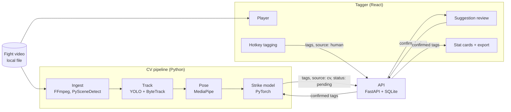

# StrikeLens

**Count a fight in a fraction of the time, with numbers you can still trust.**

StrikeLens is a human-in-the-loop fight analytics tool for kickboxing. Analysts tag
strikes fast with hotkeys. A computer vision (CV) model suggests where strikes
probably happened. Every fight turns into stats automatically.

v1 targets Byon Combat kickboxing footage (an Indonesian promotion).

> **Status: foundation stage.** The repo, docs, CI, and skeleton apps exist. No
> product features are built yet. See the [roadmap](docs/roadmap.md).

<!-- Screenshot: replace with a capture of the tagger once issue #9 lands. -->
<!--  -->

## What it does (v1)

- Load a fight video and tag each strike with keyboard shortcuts: fighter (red or
  blue), weapon, outcome (landed, missed, blocked), and target (head, body, legs).
- Calculate attempts, landed, accuracy, strikes per minute, per-round splits,
  weapon mix, and target distribution.
- Track both fighters and estimate their pose, then flag likely strike moments.
  The analyst jumps between flags and confirms or rejects each one.
- Export stat cards (PNG, Instagram 4:5) and data (CSV).

## What it does not do (v1)

- It does not detect landed strikes or targets on its own. A person confirms those.
- It does not replace the analyst. The model suggests; the analyst decides.
- It does not host or share footage. Video stays on the analyst's machine.

Every confirmed tag becomes training data, so the suggestions should improve over time.

## Stats coverage

| Stat | How it's produced in v1 | Later goal |
|---|---|---|
| Fight time, round splits | Automatic (round start/end marked once) | Automatic round detection |
| Fighter tracking, ring position, pressure | Automatic (CV) | Same |
| Strike attempts | CV suggests, analyst confirms | Mostly automatic |
| Strikes per minute, per round | Calculated from confirmed attempts | Same |
| Weapon (punch, kick, knee, elbow) | CV suggests, analyst confirms | Mostly automatic |
| Landed vs missed, accuracy | Analyst tags | CV suggestion |
| Target (head, body, legs) | Analyst tags | CV suggestion |
| Defensive responses | Analyst tags | Research stretch |

Formulas and open questions are in [docs/stat-definitions.md](docs/stat-definitions.md).

## Architecture



More detail in [docs/architecture.md](docs/architecture.md).

## Tech stack

All free and open source.

| Layer | Tools |
|---|---|
| Tagging app | React, Vite, TypeScript, Tailwind CSS, Recharts, Vitest |
| API | FastAPI, Pydantic v2, SQLAlchemy, pytest |
| Database | SQLite locally (Supabase Postgres later) |
| Video | FFmpeg, OpenCV, PySceneDetect |
| Detection and tracking | Ultralytics YOLO, ByteTrack |
| Pose | MediaPipe for v1, RTMPose as the upgrade path ([ADR 0004](docs/decisions/0004-pose-library.md)) |
| Strike model | PyTorch (temporal CNN or LSTM on keypoint sequences) |
| Training compute | Google Colab, Kaggle Notebooks |
| Tooling | uv, Ruff, npm, ESLint, Prettier, GitHub Actions |

## Quick start

You need Node 20+, Python 3.11+, and [uv](https://docs.astral.sh/uv/).

```bash
git clone https://github.com/suryalionael/strikelens.git
cd strikelens

# Tagger: http://localhost:5173
cd apps/tagger && npm install && npm run dev

# API: http://localhost:8000/health
cd apps/api && uv sync && uv run uvicorn app.main:app --reload

# CV package
cd cv && uv sync && uv run strikelens-cv --version
```

Full instructions, including tests and lint, are in [docs/dev-setup.md](docs/dev-setup.md).

## Repo map

```
apps/tagger/     React tagging app
apps/api/        FastAPI service, pure stat functions in app/stats/
cv/              CV pipeline package (strikelens_cv)
shared/schema/   JSON Schemas shared by all parts (tag, fight, fighter)
docs/            Project docs and decision records
data/            Local footage and labels (gitignored)
models/          Local model weights (gitignored)
scripts/         Dev helper scripts
```

## Roadmap

| Phase | Due | Gate |
|---|---|---|
| Phase 0 · Setup | 2026-11-08 | Repo, docs, CI green |
| Phase 1 · Tagging app MVP | 2026-11-29 | Gate 1: demo to Freefly, one fight tagged and compared with their numbers |
| Phase 2 · CV baseline | 2026-12-13 | Gate 2: overlay demo video ready to share |
| Phase 3 · Strike suggestions | 2027-01-31 | Gate 3: assisted tagging works end to end on a full fight |
| Phase 4 · Validate and ship v1 | 2027-02-21 | Gate 4: v1 handed over to Freefly |

Dec 14 to Jan 3 is exam and winter break buffer. Details in [docs/roadmap.md](docs/roadmap.md).

## Data policy

Footage, frames, keypoints, labels, and model weights never go in git. Byon Combat
owns the footage. Freefly Metrics owns their tags. Everything under `data/` and
`models/` is gitignored, and a pre-commit hook blocks files over 5 MB. Read
[docs/data-policy.md](docs/data-policy.md) before working with any video.

## Contributing

See [CONTRIBUTING.md](CONTRIBUTING.md). Contributors follow the
[Code of Conduct](CODE_OF_CONDUCT.md).

## Licence

[AGPL-3.0](LICENSE). Ultralytics YOLO is AGPL-3.0, so StrikeLens is too
([ADR 0002](docs/decisions/0002-agpl-licence.md)).

## Credits

Built by [Lionael Surya](https://github.com/suryalionael) for a proposed
collaboration with Freefly Metrics ([@freefly.combat](https://www.instagram.com/freefly.combat/)).
Not affiliated with Byon Combat.
