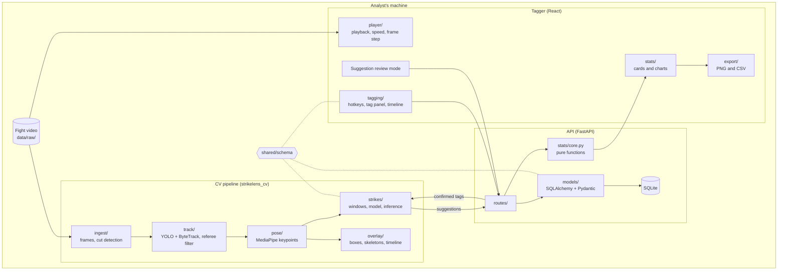
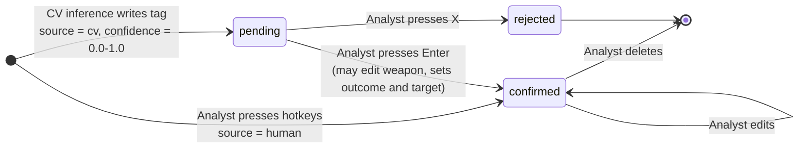
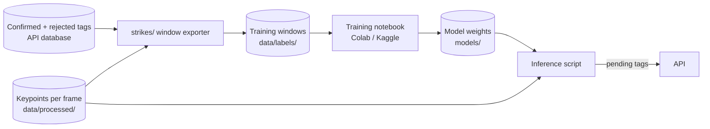

# Architecture

StrikeLens has three parts that share one data shape.

| Part | Folder | Runs where | Job |
|---|---|---|---|
| Tagger | `apps/tagger` | Browser | Play video, tag strikes, review suggestions, show and export stats |
| API | `apps/api` | Local server (later free-tier host) | Store fights and tags, calculate stats |
| CV pipeline | `cv` | Analyst's machine, Colab, or Kaggle | Turn video into tracks, keypoints, and strike suggestions |

The shared shapes live in `shared/schema/` as JSON Schemas: `tag`, `fight`, `fighter`.

## Component view

### Tagger

- Loads a local video file with the browser's file picker. The video never uploads.
- Hotkeys build a tag (fighter, weapon, outcome, target) and save it with the
  current video time. Hotkeys are in [tag-schema.md](tag-schema.md).
- Shows a per-round timeline with red and blue lanes. Click a tag to seek.
- Review mode steps through pending CV suggestions.
- Marks replays and non-fight segments, and flags tags inside them.
- Displays stats returned by the API. Components do no stat math.

### API

- CRUD for fights, fighters, rounds, and tags. SQLite file in `data/` locally.
- Validates tags against the shared schema.
- Stat endpoints call pure functions in `app/stats/core.py`. Those functions take
  plain lists and numbers, so they are easy to test and reuse in the CV evaluation.

### CV pipeline

Stages run in order. Each stage reads from and writes to `data/processed/`.

1. **Ingest:** FFmpeg extracts frames at a fixed rate. PySceneDetect finds camera
   cuts. Runs of short shots in the cut list are written out as likely replays
   (`segment-suggestions.json`). The analyst loads them in the tagger, accepts or
   dismisses each, and marks other replays and non-fight shots by hand. Segments
   are saved on the fight. Later stages call `frames_outside` so they skip them.
2. **Track:** YOLO detects people. ByteTrack links detections within each shot. A
   pure assignment step keeps two fighters per shot and matches them to red and
   blue across cuts by the colour of their shorts. Corrections fix it by hand.
   Tracks whose chest is mostly not skin are dropped as the referee (#20).
3. **Pose:** MediaPipe estimates 33 keypoints in each fighter box (padded a little),
   per frame, and writes `keypoints/red.json` and `blue.json`. Missing frames are
   null with a reason. The backend is swappable for RTMPose (ADR 0004).
4. **Strikes:** a temporal model (CNN or LSTM) reads keypoint windows and outputs
   strike candidates with a weapon guess and a confidence.
5. **Overlay:** renders boxes, skeletons, and a strike timeline onto video for demos.

## Tag lifecycle

A suggestion and a human tag are the same object. Only `source`, `confidence`,
and `status` differ.

Rules:

- Only `confirmed` tags count toward stats.
- Confirming a suggestion keeps `source: "cv"`. That records that the model found
  the strike, which matters for evaluation (issue #28).
- A tag cannot be `confirmed` without a weapon, outcome, and target. The schema
  enforces this.
- Rejected suggestions are kept, not deleted. They are negative examples for training.

## From confirmed tags to training data

1. For each confirmed tag, cut a window of keypoints around `timestamp_ms` for the
   fighter who threw it. Label it with the weapon.
2. Sample windows with no strike as negatives, plus rejected suggestions.
3. Train in a notebook on free GPU time. Save weights to `models/` (never git).
4. Run inference on a new fight. Peaks above a threshold become pending tags.
5. Analyst review produces more confirmed and rejected tags. Repeat.

Window length, stride, and threshold are decided in issues #23-#25 and recorded as ADRs.

## Data locations

| What | Where | In git? |
|---|---|---|
| Source video | `data/raw/` | No |
| Frames, tracks, keypoints | `data/processed/` | No |
| Exported tags, training windows | `data/labels/` | No |
| SQLite database | `data/` | No |
| Model weights | `models/` | No |
| Schemas, configs, code, docs | everywhere else | Yes |

See [data-policy.md](data-policy.md).
